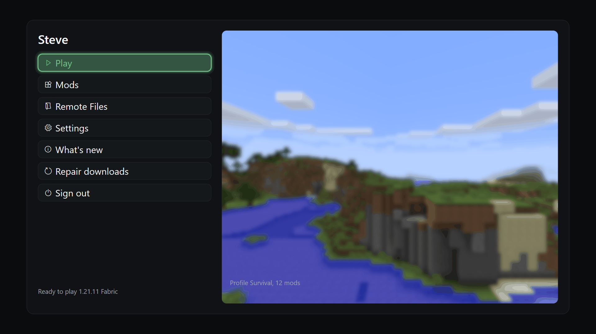
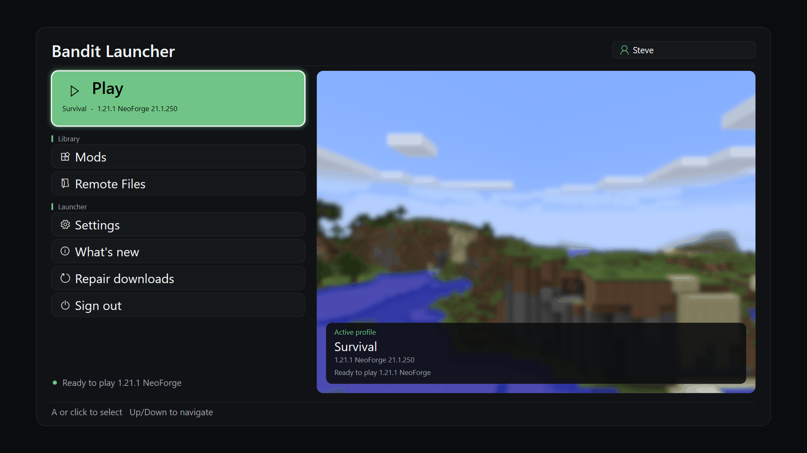
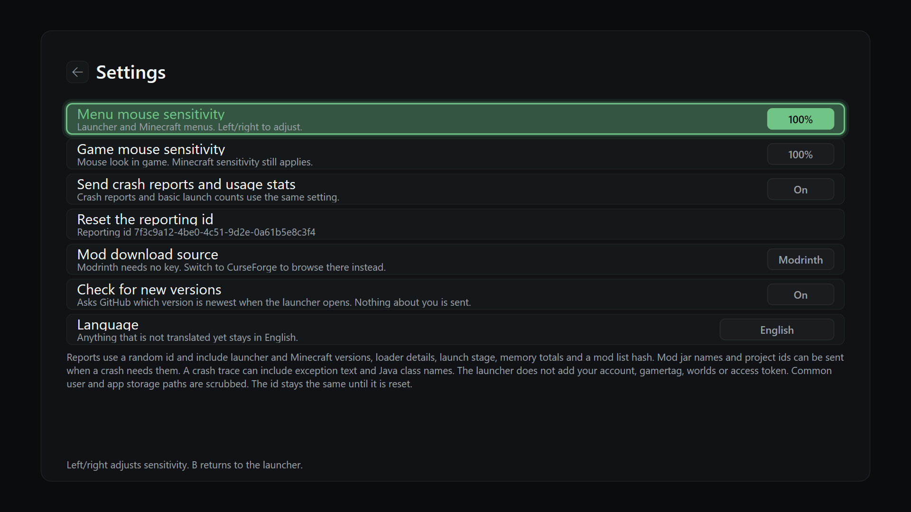
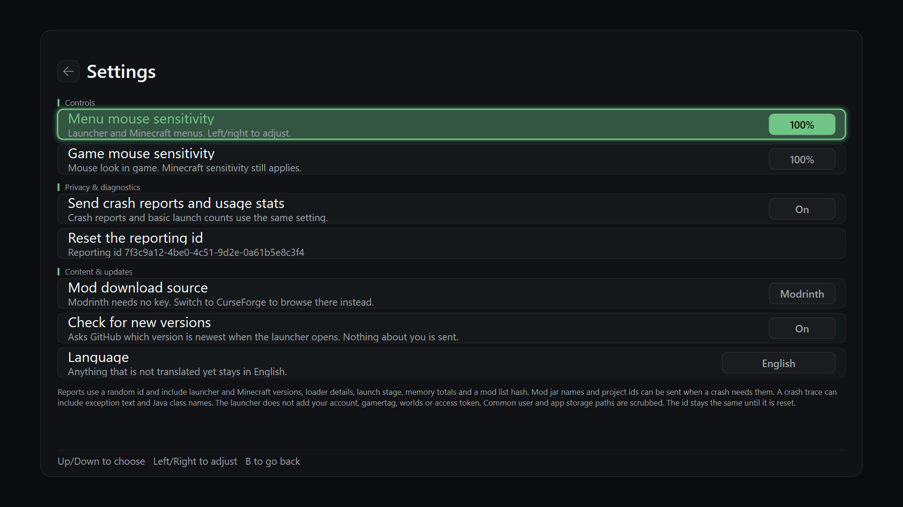

# Ergonomía del Launcher: análisis, cambios y sugerencias

_fecha: 2026-11-02 · rama `arena/16fba603-javauwp`_

Este documento recoge el análisis de la capa de interfaz del fork **Native + NeoForge**, los cambios de ergonomía aplicados y las sugerencias priorizadas que quedan para una segunda iteración. Las capturas son renders reales del renderer Direct2D del launcher, generados con `tools/ui-preview` en un runner de Windows (no son maquetas).

| Antes | Después |
| --- | --- |
|  |  |
|  |  |

Otras pantallas del "después": [`main-menu-update.png`](previews/after/main-menu-update.png), [`main-menu-sign-out-confirm.png`](previews/after/main-menu-sign-out-confirm.png), [`mods-1-popular.png`](previews/after/mods-1-popular.png).

---

## 1. Cómo está construida la UI (diagnóstico estructural)

| Pieza | Archivo | Qué hace |
| --- | --- | --- |
| Bucle de pantalla | `MC.Xbox/ui/launcher_ui.cpp` (~1060 líneas) | Cada pantalla es una función con su propio `while(true)` a 16 ms, su propio estado de teclas "wasDown" y su propia lógica de hover/click. |
| Estado | `MC.Xbox/ui/auth_ui_state.h` (~125 líneas) | Un único `AuthUiState` plano con ~75 campos para 9 pantallas distintas y 9 booleanos `show*` mutuamente excluyentes (sin enum que lo garantice). |
| Renderer | `MC.Xbox/ui/auth_screen.h` (~1900 líneas) | Un único `Render()` con una cadena de `if (state.showX)`; cada rama dibuja su layout con números literales. |
| Hit testing | `AuthScreenRenderer::RegisterHit` / `HitTest` | Regiones rectangulares registradas a mano durante el dibujo; el menú principal usa además un array paralelo `mainMenuRects_`. |
| Entrada | `MC.Xbox/ui/launcher_mouse.*`, `launchhit::*` | Ratón USB nativo con acumulación de deltas crudos + sensibilidad; IDs de hit repartidos por rangos numéricos (`kTabBase=100`, `kProfileGridBase=200000`). |
| Preview | `tools/ui-preview/{render.ps1,ui_preview.cpp}` | Compila el renderer como EXE de escritorio y vuelca cada escena a PNG a 1920×1080. |

Es UI inmediata (Immediate Mode): no hay árbol de widgets, no hay layout engine, no hay foco declarativo. Eso es una decisión razonable para UWP/Xbox —pocas asignaciones, control total sobre D2D— pero tiene tres costes que se notan en la ergonomía:

1. **El estado y el dibujo no comparten una fuente de verdad.** `selectedMenuIndex`, `settingsSelected`, `modsFocus`, `crashSelected` y `changelogSelected` son enteros independientes; `status`/`detail` son cadenas de propósito general que cada pantalla reescribe.
2. **Las constantes de composición viven dentro de cada rama.** Márgenes de `36`, `54`, `58`, alturas de `56`, `64`, `40`… repetidos y divergentes entre pantallas.
3. **La jerarquía visual la decide cada bucle de forma local.** De ahí que una pantalla tenga cabecera y pie y otra no, o que el mismo gesto (`B`, `Escape`) esté documentado de forma distinta.

## 2. Problemas concretos detectados en el "antes"

1. **Sin jerarquía de acción.** Siete botones idénticos en una sola columna: *Play* pesaba lo mismo que *Sign out*. En un mando, "jugar" estaba a un paso y "cerrar sesión" a seis, con la misma apariencia.
2. **Acción destructiva sin guardarraíl.** *Sign out* estaba justo debajo de *Repair downloads*: un doble pulso del D-pad podía cerrar la sesión de Microsoft (y con ella el entitlement) sin confirmación.
3. **Contexto ilegible.** El perfil activo y el target se dibujaban en gris (`kTextMuted`) **encima** de una panorámica clara; en la captura real casi desaparecen. La cuenta de usuario estaba en una línea minúscula abajo a la izquierda.
4. **Contexto volátil.** Al primer movimiento del cursor el bucle hacía `state.detail = L""`; al volver de Mods se sobrescribía con `Tr(L"Browse installed, popular, and latest Fabric mods.")` —un texto que además era **incorrecto en este fork**, cuyo target por defecto es NeoForge. Al salir de Ajustes quedaba `"Crash reporting is off"` y al salir de Remote Files, `"Remote file manager stopped"`.
5. **Espacio mal repartido.** Debajo de los siete botones quedaban ~250 px vacíos mientras el 66 % derecho lo ocupaba una imagen decorativa sin información; en Ajustes ocurría lo contrario: siete filas y un muro de texto apretados arriba y un gran vacío abajo.
6. **Ayudas inconsistentes.** Ajustes decía "Left/right adjusts sensitivity. B returns" para las siete filas (solo dos son sensibilidad), Remote Files tenía otra frase, Changelog otra, y el menú principal no tenía ninguna.
7. **Cursor poco visible.** Una cruz blanca de 28 px sin contorno: sobre las capturas claras se perdía, y a distancia de sofá en 1080p es demasiado pequeña.
8. **Deriva de build.** `runtime_config.h.in` se sustituía con 10 `.Replace()` dentro de `build.ps1`, mientras el preview exigía haber ejecutado antes un `build.ps1` completo sólo para generar esa cabecera.

## 3. Cambios aplicados

### Composición del menú principal
- **Play como hero**: tarjeta de acento de 132 px con icono grande, subtítulo con perfil y target, y borde reforzado al seleccionar. Deja de ser un botón más.
- **Agrupación por intención**: `Library` (Mods, Remote Files) y `Launcher` (Settings, What's new, Repair downloads, Sign out), con marcadores de sección y aire entre grupos. Se mantiene el orden de índices 0..6, por lo que la navegación con mando/ratón no cambia.
- **Cabecera persistente**: título de la app a la izquierda y chip de cuenta a la derecha sobre superficie oscura, separada por una línea.
- **Tarjeta de perfil**: fondo oscuro al 88 % sobre la panorámica con "Active profile", nombre, target y estado; ahora legible con cualquier captura de fondo.
- **Badge de actualización** en la esquina de la panorámica, además del cambio de etiqueta en la fila *What's new*.
- **Barra de pie** con las ayudas reales de la pantalla (`A o clic / Up-Down`), línea separadora y estado con punto de color arriba.

### Comportamiento
- **Confirmación de Sign out en dos pasos**: primer `A` muestra un aviso rojo en la propia fila y en el pie; sólo un segundo `A` (en menos de 4 s y sin mover el foco) cierra la sesión. Navegar a otra opción cancela el guardarraíl.
- **`MainMenuSummary`** (`auth_ui_state.h`): `account`, `profileName` y `targetText` como datos tipados. La cabecera, el hero y la tarjeta son tres vistas de los mismos hechos; ya no dependen de `status`/`detail`.
- **`RefreshMainMenuSummary()`**: se recalcula al entrar y **al volver de Mods**, donde se puede crear/renombrar/activar un perfil. Así el hero refleja el target que realmente se va a lanzar.
- **Ajustes y Remote Files** guardan y restauran `status`/`detail` al cerrar (igual que ya hacía Changelog), en vez de dejar mensajes de otras pantallas en el dashboard.
- **Texto obsoleto de Fabric eliminado** y sustituido por la restauración del resumen de perfil.
- **Cursor** con halo oscuro, contorno negro y punto de acento: visible sobre fondo oscuro y sobre capturas claras.

### Estructura reutilizable
- `namespace layout` en `auth_screen.h`: `kInset`, `kHeaderH`, `kFooterH`, `kRowH`, `kRowGap`, `kSectionH`, `kHeroH`, `kCorner`, `kColumnRatio`, `kColumnGap`. Las pantallas nuevas deben tomar los números de ahí.
- `DrawSectionLabel()` y `DrawFooterBar()`: componentes compartidos usados por el menú y Ajustes, en lugar de texto de ayuda inventado en cada rama.
- Ajustes se reorganiza en **Controls / Privacy & diagnostics / Content & updates**, con la nota de privacidad en tipografía secundaria para que deje de competir con las filas.
- `scripts/gen-runtime-config.ps1` es ahora la **única** fuente de sustitución de tokens: lo usan `build.ps1` y `tools/ui-preview/render.ps1` (que ya no necesita un build APPX previo). `scripts/validate-fork-targets.py` comprueba que los 10 tokens siguen sustituyéndose ahí.
- `.github/workflows/ui-preview.yml` renderiza todas las escenas en Windows, regenera `MC.Xbox/lang/en.json` con `scripts/update-translations.ps1` y publica un set curado en `docs/previews/<subdir>/` (`before` / `after`, elegido con `docs/previews/.render`).
- `MC.Xbox/lang/es-419.json`: traducción de las 9 cadenas nuevas y limpieza de 5 cadenas que ya no existen en el código.

## 4. Sugerencias para la siguiente iteración (priorizadas)

| # | Sugerencia | Por qué | Coste |
| --- | --- | --- | --- |
| 1 | **Un `enum class Screen` + `SetScreen()`** en `AuthUiState`, y que `Render()` use un `switch`. | Hoy 9 booleanos `show*` pueden contradecirse; un enum hace imposible pintar dos pantallas a la vez y documenta la navegación. Es el mayor riesgo estructural actual. | Medio |
| 2 | **Modelo de foco único** (`FocusTarget { screen, zone, index }`) con `MoveFocus(dx, dy)`. | Sustituye cinco enteros de selección y permite navegación espacial real (arriba/abajo/izquierda/derecha) en lugar de "siguiente/anterior". Habilita grid de 2 columnas en el menú. | Medio-alto |
| 3 | **Atajos de teclado** (`P` Play, `M` Mods, `S` Settings, `F1` ayuda) y `Home`/`End`. | En la edición *native* hay teclado USB: saltar de 6 pulsos del D-pad a 1 tecla es la mejora de ergonomía más barata por línea de código. | Bajo |
| 4 | **Split de `Render()`** en `RenderMainMenu()`, `RenderSettings()`, `RenderMods()`… en `auth_screen.cpp`. | 1900 líneas en una cabecera es el límite práctico para mantener; dificulta revisar cambios y hace que cada preview compile todo. | Medio (mecánico) |
| 5 | **Layout declarativo por porcentajes + `displayScale_`**. | Todo está en DIP fijos a 1920×1080; en 4K con escalado o en modo TV con overscan distinto conviene derivar márgenes del frame, no constantes absolutas. | Medio |
| 6 | **Hover con feedback y delay de repetición** para D-pad, más `TakeClick()` sólo cuando el hit es válido. | Hoy el hover cambia la selección en cuanto se mueve el ratón y un click en vacío se consume igual. En sofá, el "key repeat" del mando importa. | Bajo |
| 7 | **Memoria de foco entre pantallas y breadcrumb**. | Al volver de Mods, `selectedMenuIndex` se conserva, pero `modsFocus`/tab no; una migaja de pan (`Launcher / Mods / Popular`) reduce la carga cognitiva en una UI sin ventana. | Bajo-medio |
| 8 | **Empty states con acción** en Mods (hoy "No shaders found" sin botón) y **confirmación también para Repair downloads**. | Coherencia: toda acción costosa o destructiva pide confirmación; todo estado vacío ofrece una salida. | Bajo |
| 9 | **Accesibilidad de color**: no depender sólo del verde para "seleccionado" (añadir grosor de borde/icono), y subcontraste de `kTextMuted` sobre `kSurface` en textos < 21 px. | El acento verde es la única señal de foco; en televisiones con calibración fría puede perderse. | Bajo |
| 10 | **Prueba en consola real**. | Ningún cambio de UI se ha validado en Xbox: aquí sólo hay render offscreen en Windows. Medir tiempo hasta Play, errores de selección y legibilidad a 2-3 m. | — |

## 5. Cómo reproducir las capturas

En Windows con Visual Studio, Windows SDK y un JDK:

```powershell
.\tools\ui-preview\render.ps1 -OutDir .local\ui-preview
```

`render.ps1` genera `staging/build/MC.Xbox/runtime_config.h` con `scripts/gen-runtime-config.ps1` si no existe, compila `ui_preview.exe` y escribe un PNG por escena. En CI, el workflow `UI preview` hace lo mismo y además regenera `en.json`; el archivo `docs/previews/.render` contiene la carpeta de destino (`before`/`after`) y actúa como disparador.

## 6. Límites de verificación

- Compilación del renderer validada en **Windows** mediante `ui_preview.exe` (el workflow compila `auth_screen.h`, `i18n.cpp`, `profiles.cpp`, etc. con MSVC). No hay compilación UWP/MSVC del paquete completo ni ejecución en Xbox en este entorno.
- `bash tests/run-tests.sh` pasa (15 aserciones C++ + validador de catálogo/config). `en.json` se regenera con el script oficial en CI; `es-419.json` se validó en cuanto a JSON y placeholders.
- El workflow de UI preview no construye APPX. El trabajo de NeoForge, la autenticación Microsoft y la verificación de propiedad permanecen intactos.
